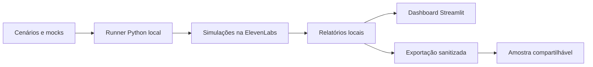

# ElevenLabs Agent Evals

Um workflow de avaliação por texto para agentes da ElevenLabs: cenários, respostas controladas de ferramentas, verificações em Python e um dashboard em Streamlit.

O exemplo é a **Ponte Idiomas**, um agente que responde dúvidas sobre cursos e orienta a escolha do aluno. O projeto permite estudar o processo de avaliação e adaptá-lo ao próprio agente.

| Quero… | Por onde começar |
|---|---|
| Ver o resultado sem instalar nada | [Abrir a demonstração online](https://ponte-idiomas-evals.streamlit.app/) |
| Explorar a amostra deste repositório | [Abrir o dashboard localmente](#abrir-o-dashboard-localmente) |
| Avaliar meu próprio agente | [Guia de adaptação](docs/COMO-ADAPTAR.md) |
| Entender o método e suas limitações | [Metodologia](docs/METODOLOGIA.md) |
| Aprender a navegar pelo projeto | [Guia do GitHub](docs/COMO-USAR-GITHUB.md) |

## O que está incluído

- Uma suíte com **20 cenários** e uma seleção inicial de três: perguntas objetivas, recomendações, limites, mudanças de intenção e tratamento de falhas.
- Catálogos de teste e retornos de erro para a ferramenta `consultar_cursos`.
- Execução pelo SDK da ElevenLabs, com prévia local por padrão e envio explícito com `--executar`.
- Relatórios JSON e CSV, transcrições e evidências da ferramenta.
- Dashboard para comparar rodadas e investigar os resultados.
- Testes do próprio programa, executados com HTTP simulado.
- **Dois lotes históricos sanitizados**, com 22 execuções de cenários e 9.451 créditos informados.

O dashboard online apresenta a demonstração completa do estudo, com seis lotes e 51 execuções. Este repositório contém um recorte de dois lotes para facilitar a exploração e a reutilização. Abrir qualquer um dos painéis **não inicia avaliações nem consome créditos da ElevenLabs**.

## Como as partes se conectam



O GitHub guarda os arquivos e seu histórico. A ElevenLabs executa as simulações e avalia os critérios de conteúdo; o Python confere evidências e organiza os relatórios. O Streamlit apresenta os resultados.

## Abrir o dashboard localmente

Use **Python 3.12**. Baixe ou clone o repositório e abra o terminal na pasta do projeto.

No Windows:

```powershell
py -3.12 -m venv .venv
.\.venv\Scripts\python.exe -m pip install -r requirements.txt
.\.venv\Scripts\python.exe -m streamlit run dashboard.py
```

No Linux ou macOS:

```bash
python3.12 -m venv .venv
.venv/bin/python -m pip install -r requirements.txt
.venv/bin/python -m streamlit run dashboard.py
```

Abra o endereço mostrado no terminal. A amostra já está incluída em `lotes/`; não é necessário ter conta, agente ou chave da ElevenLabs para explorá-la.

Experimente escolher um lote, abrir uma conversa e usar **Comparar lotes**. O botão **Atualizar relatórios** apenas relê os arquivos daquele ambiente.

## Usar com o próprio agente

O runner é um ponto de partida orientado ao caso de cursos. A configuração completa do agente, seus prompts, a base institucional e a integração original não foram exportadas. Para executar novas avaliações, você precisa de um agente próprio e deve adaptar o contrato da ferramenta e os cenários ao seu contexto.

O [guia de adaptação](docs/COMO-ADAPTAR.md) explica a instalação adicional, o `.env` local, os critérios e a execução. A primeira conferência é uma prévia sem chamadas à API:

```powershell
.\.venv\Scripts\python.exe avaliar_lote.py --preview --suite cenarios/suite-minima.json
```

Instale antes `requirements-evals.txt`, conforme o guia. A suíte mínima contém os exemplos 01, 11 e 17; adapte-os ao seu agente. O modo `--executar` solicita novas simulações e pode consumir créditos. Confira conversas, notas e evidências antes de ampliar.

## O aprendizado central do case

Uma rodada recebeu **20 aprovações automáticas em 20 cenários**. A revisão das evidências mostrou dois problemas relevantes:

- No caso 07, o agente repetiu uma pergunta antes da resposta do usuário, apesar de um critério que deveria impedir esse comportamento.
- No caso 14, a resposta final foi adequada, mas houve 135 oscilações entre dois nós. O cenário registrou 137 chamadas de transição e 3.384 créditos, cerca de 39% do consumo daquela rodada.

O recorte conserva as avaliações automáticas originais. Essas observações humanas são explicadas na [metodologia](docs/METODOLOGIA.md), sem inventar novas notas nos relatórios. O objetivo é mostrar como investigar conteúdo, fluxo e custo em conjunto.

## Autoria e uso do Codex

Projeto de estudo conduzido por **[CarlosEZanardo](https://github.com/CarlosEZanardo)**, com assistência do Codex.

O autor definiu o objetivo do exercício, configurou o agente na ElevenLabs, executou os experimentos, revisou os atendimentos e decidiu os ajustes ao longo do aprendizado.

O **Codex** apoiou a estruturação dos cenários, a implementação e explicação do código, os testes do programa, a consolidação dos relatórios, o dashboard, a investigação de falhas e a preparação dos materiais para publicação. O desenvolvimento foi acompanhado por perguntas, execução prática e revisão dos resultados.

Os conceitos de avaliação foram estudados no curso [Building with the Claude API, da Claude Academy](https://academy.claude.com/courses/building-with-the-claude-api/a-typical-eval-workflow). Neste projeto, as simulações e o julgamento de conteúdo são realizados pelos recursos de testes da **ElevenLabs**; o Codex foi usado como assistente de desenvolvimento.

Este é um case educacional independente, sem vínculo ou endosso das empresas mencionadas.

## Organização dos arquivos

| Caminho | Responsabilidade |
|---|---|
| `cenarios/` e `CENARIOS-20.md` | Definições dos testes e versão de leitura |
| `fixtures/` | Respostas controladas da ferramenta |
| `avaliar_lote.py` | Cadastro e execução dos cenários selecionados |
| `relatorios_lote.py` | Consolidação e conferência de evidências |
| `avaliar.py` | Exemplo inicial de avaliação individual |
| `dashboard_dados.py` e `dashboard.py` | Leitura dos relatórios e interface |
| `lotes/` | Dois lotes sanitizados da demonstração |
| `scripts/exportar_demo.py` | Projeção dos resultados para compartilhamento |
| `tests/` | Testes do código com dados e HTTP simulados |
| `.env.example` | Modelo vazio para configurações locais |

Para verificar o programa sem chamadas reais à API, instale os dois arquivos de dependências e execute:

```powershell
.\.venv\Scripts\python.exe -m unittest discover -s tests -v
```

## Dados e limites

Os dados publicados foram revisados: identificadores substituídos e metadados pessoais ou operacionais desnecessários removidos. As chaves, estados locais e relatórios brutos ficam fora do Git. Novos lotes locais precisam de exportação e revisão antes de serem compartilhados.

Os 20 cenários são uma amostra didática conhecida. As avaliações por texto não medem áudio, interrupções, latência de voz ou capacidade de produção. Uma aprovação automática exige interpretação e não garante repetibilidade.

## Licença

Código disponibilizado sob a [licença MIT](LICENSE). Ao reutilizar a estrutura, adapte os cenários e confira as condições dos serviços externos utilizados.
