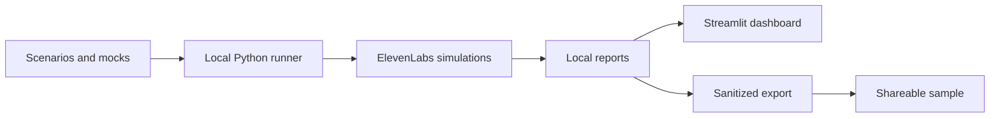

# ElevenLabs Agent Evals

A text-based evaluation workflow for ElevenLabs agents: scenarios, controlled tool responses, Python evidence checks, and a Streamlit dashboard.

The example is **Ponte Idiomas**, a language-school assistant that answers course questions and helps prospective students choose a course. Use the project to explore evaluation results and adapt the workflow to your own agent.

| I want to… | Start here |
|---|---|
| Explore without installing anything | [Open the online demo](https://ponte-idiomas-evals.streamlit.app/) |
| Explore the sample in this repository | [Run the dashboard locally](#run-the-dashboard-locally) |
| Evaluate my own agent | [Adaptation guide](docs/ADAPTATION.md) |
| Understand the method and its limits | [Methodology](docs/METHODOLOGY.md) |
| Find my way around GitHub | [Repository walkthrough](docs/GITHUB-GUIDE.md) |

## What is included

- **20 scenarios** covering course facts, recommendations, boundaries, changes of intent, and tool failures, plus a three-case starter suite.
- Catalog fixtures and error responses for the `list_courses` tool.
- Execution through the ElevenLabs SDK, with a local preview by default and an explicit `--execute` option.
- JSON and CSV reports, conversations, and tool evidence.
- A dashboard for comparing batches and investigating individual cases.
- Program tests using simulated HTTP responses.
- **Two sanitized historical batches: 22 case runs and 9,451 reported credits.**

The online demo shows the full study: six batches and 51 case runs. This repository contains a two-batch sample. Opening either dashboard **does not start evaluations or consume ElevenLabs credits**.

**Language and provenance:** the historical conversations were originally run in Brazilian Portuguese. This repository presents English translations for readability, preserving the recorded metrics and platform conclusions. These are not new English-language runs. The current English scenarios produce different payload hashes from the original Portuguese definitions; see the [methodology](docs/METHODOLOGY.md#language-and-historical-provenance).

## How the parts fit together



GitHub stores the files and their history. ElevenLabs runs the simulations and grades the content criteria; Python checks tool evidence and assembles reports. Streamlit displays the results.

## Run the dashboard locally

Use **Python 3.12**. Download or clone the repository, then open a terminal in the project folder.

Windows:

```powershell
py -3.12 -m venv .venv
.\.venv\Scripts\python.exe -m pip install -r requirements.txt
.\.venv\Scripts\python.exe -m streamlit run dashboard.py
```

Linux or macOS:

```bash
python3.12 -m venv .venv
.venv/bin/python -m pip install -r requirements.txt
.venv/bin/python -m streamlit run dashboard.py
```

Open the address shown in the terminal. The sample is already in `batches/`; exploring it requires no ElevenLabs account, agent, or API key.

Select a batch, read a conversation, and compare batches. Refreshing the dashboard simply reloads the files available in that environment.

## Use your own agent

The runner is a starting point built around the course-catalog example. The original agent configuration, prompts, institutional knowledge base, and external integration are not included. To run evaluations, configure your own agent and adapt the scenarios and tool contract.

The [adaptation guide](docs/ADAPTATION.md) covers the additional dependencies, local `.env`, criteria, and execution. Start with a preview that makes no API requests:

```powershell
.\.venv\Scripts\python.exe evaluate_batch.py --preview --suite scenarios/minimal-suite.json
```

Install `requirements-evals.txt` first, as described in the guide. The starter suite contains cases 01, 11, and 17. Its current instructions are in English, so use an English-speaking agent or adapt their language. `--execute` requests new simulations and may consume credits. Review conversations, grades, and evidence before increasing coverage.

## What the study revealed

One historical Portuguese-language batch received **20 automatic passes out of 20 cases**. Reviewing the evidence revealed two issues:

- In case 07, the agent repeated a question before the user answered, despite a criterion intended to prevent that behavior.
- In case 14, the final answer was adequate, but the workflow oscillated between two nodes 135 times. The case recorded 137 transition calls and 3,384 credits, roughly 39% of that batch's consumption.

The sample preserves the original automated conclusions. These human observations are documented in the [methodology](docs/METHODOLOGY.md); no additional manual grades were invented. The exercise shows why content, workflow, and cost need to be reviewed together.

## Authorship and use of Codex

A learning project led by **[CarlosEZanardo](https://github.com/CarlosEZanardo)**, with assistance from Codex.

The author defined the exercise, configured the ElevenLabs agent, ran the experiments, reviewed conversations, and decided which changes to make.

**Codex** supported scenario design, code implementation and explanation, program tests, reporting, the dashboard, troubleshooting, sanitization, and documentation. Development included hands-on experimentation, questions, and review of the results.

The evaluation concepts were studied through [Building with the Claude API at Claude Academy](https://academy.claude.com/courses/building-with-the-claude-api/a-typical-eval-workflow). This project uses **ElevenLabs** to run simulations and grade their content. Codex served as a development assistant.

This is an independent educational project with no affiliation with or endorsement from the companies mentioned.

## Files and responsibilities

| Path | Purpose |
|---|---|
| `scenarios/` and `SCENARIOS-20.md` | Machine-readable definitions and a readable scenario guide |
| `fixtures/` | Controlled tool responses |
| `evaluate_batch.py` | Register and run selected scenarios |
| `batch_reports.py` | Assemble reports and check evidence |
| `evaluate.py` | Original single-case example |
| `check_access.py` | Check authentication and access to the agent |
| `dashboard_data.py` and `dashboard.py` | Load reports and display the dashboard |
| `batches/` | Two sanitized, translated historical batches |
| `scripts/export_demo.py` | Prepare a shareable projection of results |
| `tests/` | Program tests with simulated data and HTTP |
| `.env.example` | Empty template for local configuration |

To check the program without real API requests, install both dependency files and run:

```powershell
.\.venv\Scripts\python.exe -m unittest discover -s tests -v
```

## Data and limitations

Published data has been reviewed: identifiers were replaced and unnecessary personal or operational metadata removed. Keys, local state, and raw reports stay out of Git. Export and review new local batches before sharing them.

The scenarios are a small, known educational dataset. Text simulations do not measure audio, interruptions, voice latency, or production capacity. A recorded automatic pass requires interpretation and does not establish repeatability or predict performance in another language.

## License

The code is available under the [MIT license](LICENSE). Adapt the examples to your context and check the terms of any external services you use.
